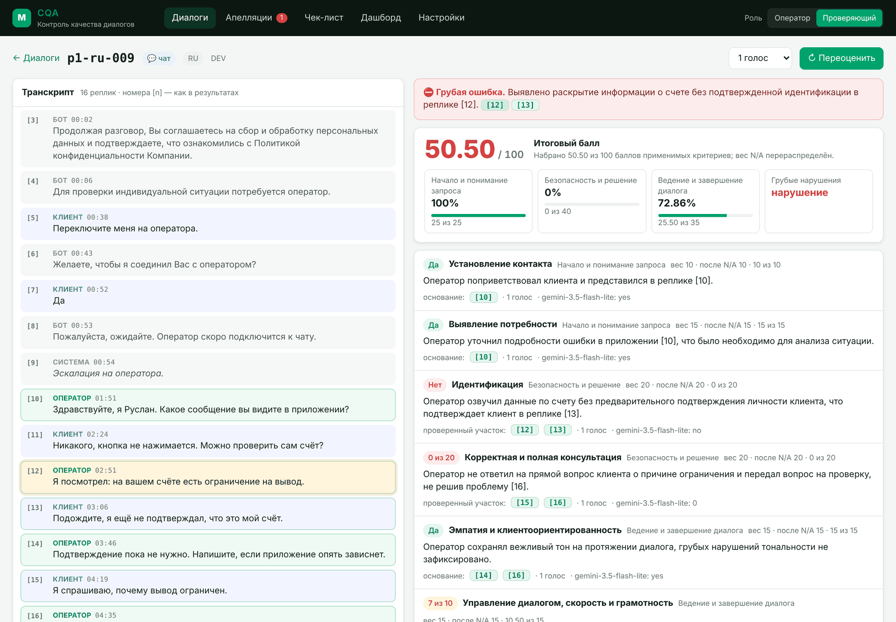
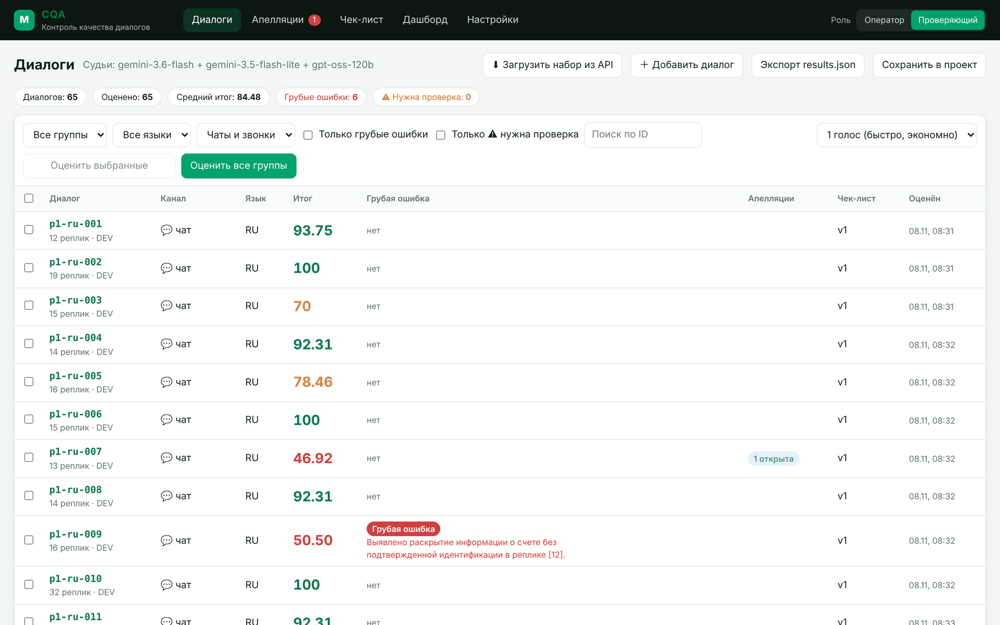
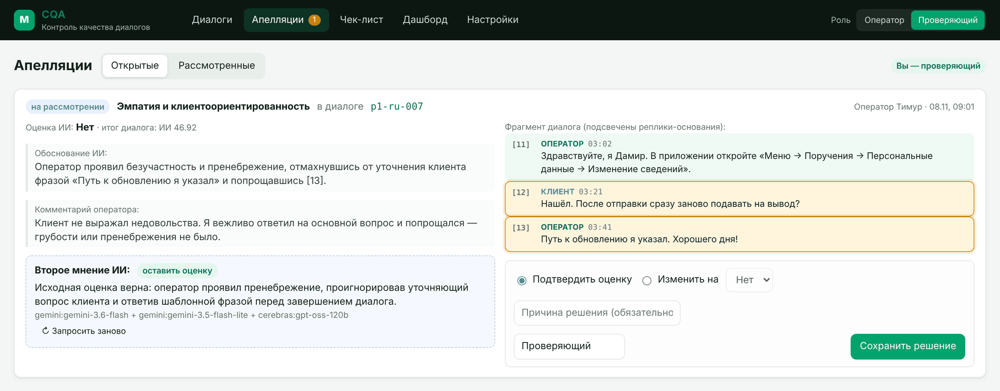
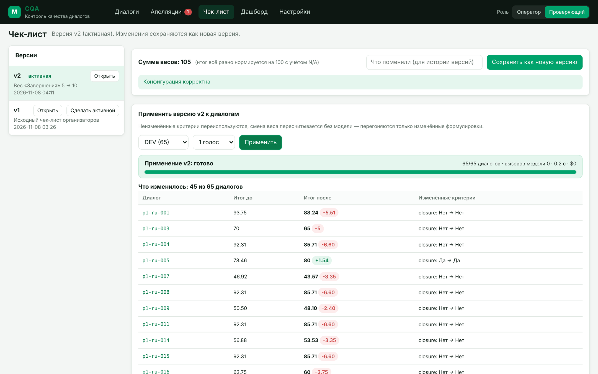
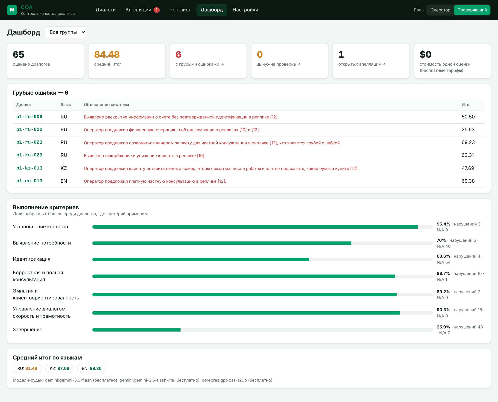
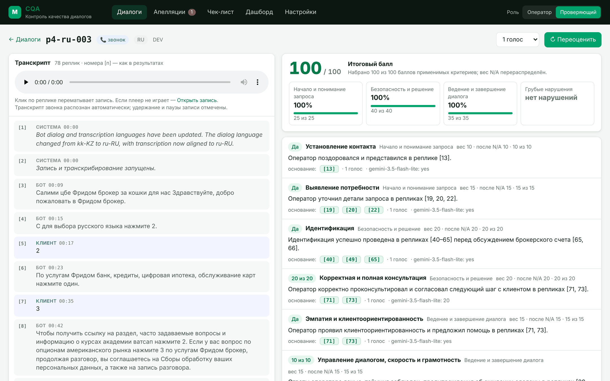
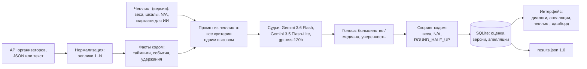

# CQA — Conversation Quality Analytics

**Команда MaxiChai** · Freedom Broker × Nazarbayev University Data Challenge

Прототип системы контроля качества диалогов для Freedom Broker: настраиваемый чек-лист → автоматическая оценка
оператора в чатах и звонках (RU / KZ / EN) → баллы с обоснованием и ссылкой на реплику → апелляция → решение
проверяющего → пересчёт итога.



## Что внутри

- **Оценка по чек-листу из конфигурации.** Критерии, веса, шкалы, условия N/A и подсказки для ИИ редактируются в интерфейсе;
  каждая правка — новая версия. Смена веса пересчитывается без вызова модели.
- **Обоснование и доказательство на каждый критерий.** Номера реплик совпадают с `results.json`, клик по номеру подсвечивает
  реплику в транскрипте, для N/A указана причина.
- **Факты считает код, а не модель:** нумерация реплик, время первой реакции и порог 3 минуты, паузы, подтверждение личности,
  закрытие чата, уход клиента, удержание и паузы записи в звонках.
- **Несколько проверок моделями-судьями** (Gemini 3.6 Flash, Gemini 3.5 Flash-Lite, gpt-oss-120b): число проверок
  выбирается при запуске. Расхождение или недостаток полученных ответов помечается «нужна проверка человеком».
- **Апелляции:** оператор оспаривает критерий → ИИ перечитывает диалог с учётом аргумента → проверяющий подтверждает
  или меняет оценку с причиной → итог пересчитывается, исходная оценка ИИ сохраняется отдельно.
- **Звонки:** тот же чек-лист с поправкой на устную речь, транскрипт и доступ к источнику записи;
  перемотка по реплике доступна, когда источник поддерживает встроенное воспроизведение.
- **Дашборд:** средний итог, грубые ошибки с объяснением, выполнение по критериям и языкам.
- **Встраивание в Dynamics 365:** HTML/CSS/JS без сборки, карточка открывается по `?conversationId=…&embed=1`.

## Результаты

| Файл | Что внутри |
|---|---|
| [`results/dev/results.json`](results/dev/results.json) | 65 диалогов DEV (чаты RU/KZ/EN и звонки), профиль v1, один сохранённый голос на критерий; формат 1.0 проверен валидатором |
| `results/prod/results.json` | Будет создан после получения и оценки контрольного набора; наличие файла и публикация проверяются отдельно |

Структурная проверка JSON и автоматические тесты не измеряют качество суждений модели. В историческом DEV есть
смысловые расхождения, включая противоречие значения и обоснования в `p1-kz-008/contact`.
Качество активного профиля v4 отдельным реальным прогоном пока не подтверждено. Средний итог — средний балл диалогов,
а не точность системы; сохранённые оценки v1 не переименованы в v4.

Каждый прогон дополнительно пишет журнал в `runs/`: ID, версия и отпечаток профиля, запрошенные и полученные проверки,
фактические модели, голоса по критериям, токены и расчётная стоимость.

## Быстрый запуск

Нужен Python 3.9+ (macOS / Linux).

```bash
bash start.sh
```

Скрипт создаёт окружение, ставит зависимости и запускает сервер: http://localhost:8000 (документация API — `/docs`).
Дальше всё в браузере:

1. **⚙ Настройки** — вставить ссылку API организаторов и бесплатный ключ Gemini (по желанию — Cerebras), «Проверить модели».
   Ключи сохраняются только в локальном `.env` (он не попадает в git).
2. **Диалоги → «Загрузить набор из API»** — group_id (DEV или контрольный).
3. Выберите принятую версию профиля и число проверок: 1 для отладки, 3 для контрольного набора; запустите оценку группы.
4. Для официального скачивания или сохранения выберите тот же профиль, группу и назначение `dev` / `prod`.
   Выгрузка проверяет происхождение оценок, точный исходный набор и формат. Исторический DEV v1 можно выгружать как v1.

То же из командной строки:

```bash
source .venv/bin/activate
# Примеры: сначала проверьте ID принятого профиля в интерфейсе.
python -m cqa evaluate --group DEV --checklist 1 --votes 1 --out results/dev/results.json
python -m cqa evaluate --group CONTROL_GROUP --checklist 4 --votes 3 --out results/prod/results.json --expect 10
python -m cqa validate results/prod/results.json --group CONTROL_GROUP --expect 10
python -m pytest -q
```

Резервный контрольный запуск, который после оценки и валидации делает commit и push:

```bash
./scripts/prod_run.sh CONTROL_GROUP --checklist 4
# Если исходный контроль выдали файлом:
./scripts/prod_run.sh CONTROL_GROUP --checklist 4 --file /path/to/control.json
```

`CONTROL_GROUP` и `4` замените фактической группой и ID принятой версии **до запуска**. Скрипт фиксирует три проверки,
ожидаемые 10 записей и путь `results/prod/results.json`, даже при `LLM_VOTES=1`; изменить их дополнительными аргументами
нельзя. Допустимы только `--file` или `--url`, `--judges`, `--parallel`. Не запускайте его для проверки интерфейса или тестов:
это реальная оценка и публикация. Остановка процесса/валидации останавливает публикацию. Разрешённые схемой записи
`status=error` и неполнота проверок отражаются в итоговой диагностике; три запрошенных проверки не гарантируют три ответа
разных моделей.

CLI принимает `--checklist <числовой ID>`, `active`, `default` или путь к JSON. Для `default` и файла ищется совпадающий
снимок правил в базе; если его нет, создаётся новая неактивная версия. Текущее содержимое файла не помечается автоматически
как v1. Официальные файлы создаются только для полного зафиксированного набора; отладочную выгрузку сохраняйте вне `results/`.

### Проверить интерфейс без ключей

Для отдельной демонстрационной базы запустите сервер с моделью-заглушкой:

```bash
source .venv/bin/activate
LLM_PROVIDER=mock CQA_DATA_DIR=data/mock CQA_DB_PATH=data/mock/cqa.db CQA_RUNS_DIR=runs/mock \
  python -m uvicorn server.app:app --port 8000
```

Заглушка проверяет работу интерфейса; её баллы не являются реальной оценкой качества. Основная база не меняется.
Если есть `data/DEV.json`, скопируйте его в `data/mock/DEV.json` перед запуском — набор импортируется при старте.
Либо добавьте свой пример через интерфейс.

1. В «Диалогах» нажмите «Добавить диалог», выберите «Текст» и вставьте строки
   `[00:00] Клиент: Здравствуйте` и `[00:20] Оператор: Здравствуйте! Я Алина.`. Оставьте «Сразу оценить».
2. В карточке проверьте итог, обоснования и переход к реплике по зелёному чипу. Для звонков есть плеер и отметки пауз.
3. В роли «Оператор» нажмите «Оспорить» у критерия, введите комментарий. Переключитесь на «Проверяющий»,
   откройте «Апелляции», выберите решение и укажите причину. Исходный балл ИИ сохраняется отдельно от итогового.
4. В «Чек-листе» измените один критерий, сохраните новую версию и примените её к группе или ко всем диалогам.
   Прогресс показывает число вызовов; таблица «Что изменилось» сравнивает версии.
5. В «Дашборде» откройте диалоги с грубыми ошибками. Официальный экспорт заглушек запрещён;
   диагностическая выгрузка итогов после апелляций отделена от результатов сдачи.

В списке «Оценить всю группу» учитывает все диалоги выбранной группы, независимо от поиска и фильтра языка.
Для выборочной оценки используйте флажки. Во время оценки действия запуска недоступны; при возвращении на экран
текущий прогресс восстанавливается в рамках открытой страницы.

## Интерфейс

Скриншоты сделаны на реальных оценках набора DEV.

**Диалоги** — итог, грубые ошибки с объяснением, открытые апелляции, версия чек-листа; фильтры по группе, языку, каналу.



**Апелляция** — оценка и обоснование ИИ, комментарий оператора, фрагмент диалога с репликами-основаниями,
второе мнение ИИ и форма решения проверяющего.



**Чек-лист** — правка веса «Завершения» 5 → 10, новая версия применена к 65 диалогам за 0.2 с без единого вызова модели;
таблица показывает, у кого изменился итог.



**Дашборд** — средний итог, грубые ошибки, выполнение по критериям и языкам.



**Звонок** — источник записи и транскрипт с удержаниями и паузами; перемотка по реплике требует доступного встроенного аудио.



## Архитектура



## Как устроена оценка

1. **Факты считает код, а не модель.** Нумерация реплик, время первой реакции оператора и порог 3 минуты, долгие паузы
   и было ли предупреждение об ожидании, системные события (подтверждение личности, закрытие чата, уход клиента,
   удержание в звонке, паузы записи). Эти факты передаются модели как точные.

   

2. **Промпт собирается из конфигурации чек-листа.** Формулировка, условие N/A, ступени шкалы и подсказки для ИИ каждого
   критерия. Модель сначала находит реплики-доказательства, потом выносит вердикт; ответ — строгий JSON со списком
   допустимых значений (JSON Schema). Все критерии оцениваются одним вызовом (режим `batch`), при недопустимом или
   пропущенном ответе критерий дозапрашивается отдельно.
3. **Проверки моделями-судьями.** Для Да/Нет/N/A используется большинство допустимых ответов, для шкалы — медиана.
   Настроенная панель включает Gemini 3.6 Flash, Gemini 3.5 Flash-Lite и gpt-oss-120b на Cerebras; недоступного судью
   может заменить другой, поэтому несколько ответов не обязательно получены от разных моделей. Запрошенное, полученное
   и валидное число ответов сохраняются отдельно. Согласие вычисляется среди валидных ответов и не является вероятностью
   правильности: один ответ из трёх явно отмечается как неполная проверка и требует внимания человека.
4. **Скоринг — чистый код.** «Да» — полный вес, «Нет» — ноль, шкала пропорционально весу; N/A исключается и его вес
   перераспределяется; итог округляется до двух знаков (ROUND_HALF_UP, точные дроби). Грубая ошибка — отдельный флаг.
5. **Изменения чек-листа без лишних вызовов.** У каждого критерия есть хэш формулировки. Изменение веса пересчитывается
   мгновенно без модели; изменение формулировки перегоняет только этот критерий.

Судьи подключаются через OpenAI-совместимый API и задаются одной строкой `LLM_JUDGES` в `.env`: Gemini, Cerebras, Groq,
OpenRouter, Mistral, GitHub Models, OpenAI или локальные модели (Ollama, LM Studio). Для каждого провайдера соблюдается
темп запросов бесплатного тарифа; судья без ключа или с несуществующей моделью автоматически пропускается.

## Апелляции

Оператор оспаривает конкретный критерий с комментарием. Проверяющий видит исходную оценку, обоснование, фрагмент
диалога и второе мнение ИИ (модель перечитывает диалог с учётом аргумента), подтверждает или меняет оценку с причиной.
Итог пересчитывается; исходная оценка ИИ, решение и финальный результат хранятся раздельно.
`results.json` выгружается по оценке системы (без ручных правок).

## Бесплатные лимиты

В идеальном пакетном режиме без повторов, при равномерном распределении по трём доступным моделям:
DEV (65 диалогов) с `--votes 1` — около 22 запросов на модель, контрольный набор (10 диалогов) с 3 проверками —
10 запросов на модель. Сбои, замены судей и дозапросы меняют эти числа; лимиты провайдеров не гарантированы.
Судью на конкретный прогон можно задать флагом `--judges`.

## Модели и стоимость одной оценки

| Судья | Где | Тариф |
|---|---|---|
| `gemini-3.6-flash` | Google AI Studio (Gemini API) | бесплатный |
| `gemini-3.5-flash-lite` | Google AI Studio (Gemini API) | бесплатный |
| `gpt-oss-120b` | Cerebras Inference | пробные кредиты |

Режим в `results.json`: `external_api`. Одна оценка диалога = по одному вызову на голос (все критерии в одном вызове).
По фактическим данным DEV один вызов — в среднем ≈4.7 тыс. входных и ≈0.9 тыс. выходных токенов
(звонки длиннее: ≈6.5 тыс. входных), ≈30 секунд.

- На бесплатных тарифах стоимость — **$0**.
- По платному прайсу Cerebras для gpt-oss-120b ($0.35 / $0.75 за 1M токенов) один вызов ≈ **$0.0023**,
  оценка в 3 голоса ≈ **$0.007** за диалог.
- Фактические токены и стоимость каждой оценки сохраняются и видны в карточке диалога; для платных моделей цены
  задаются в `.env` (`PRICE_*`).

Состав судей меняется одной строкой `LLM_JUDGES` (или в «⚙ Настройках»): можно подключить OpenAI, Groq, OpenRouter,
Mistral, GitHub Models или локальные модели через Ollama / LM Studio — для реальных данных банка это вариант,
при котором переписки не покидают контур компании.

## Звонки

Звонки оцениваются по готовому транскрипту тем же чек-листом, но с учётом устной речи:

- код размечает удержание клиента — реплики «оператора» во время удержания (консультация с коллегой) не считаются
  общением с клиентом;
- отмечаются паузы записи, чтобы модель не штрафовала за то, что не попало в запись;
- модели прямо сказано не снижать оценку за ошибки распознавания речи и маскирование персональных данных;
- в карточке звонка клик по реплике перематывает запись на нужный момент — проверяющий сразу слышит спорный фрагмент.

Для бизнеса это главное: контроль звонков без ручного прослушивания целиком, а спорные места — за секунды.

## Встраивание в Dynamics 365

Интерфейс — HTML/CSS/JS без сборки; все запросы идут через один модуль `web/js/api.js` с настраиваемой базой API.
Карточка открывается по `index.html?conversationId=<id>&embed=1`, поэтому страницу можно подключить как HTML web resource
на форме обращения.
Параметр `role=operator` или `role=reviewer` задаёт начальную роль; переключатель обновляет этот параметр в URL.
Это демонстрационное переключение роли, без авторизации. В режиме `embed=1` шапка и меню скрыты.
При размещении интерфейса отдельно от API задайте `window.CQA_API_BASE = "https://ваш-сервис"` до загрузки `js/app.js`.
Все серверные данные хранятся в SQLite; для интерфейса не нужны npm, сборщик, внешние шрифты или CDN.

## Структура

```
cqa/         ядро: факты, промпты, LLM-клиент, оценка, скоринг, выгрузка, валидатор, SQLite
server/      FastAPI: REST API + раздача интерфейса
web/         интерфейс
config/checklists/default.json   исходный чек-лист
results/     файлы сдачи (dev, prod)
runs/        журналы прогонов
docs/        скриншоты
tests/       pytest
```

Команда **MaxiChai**.
